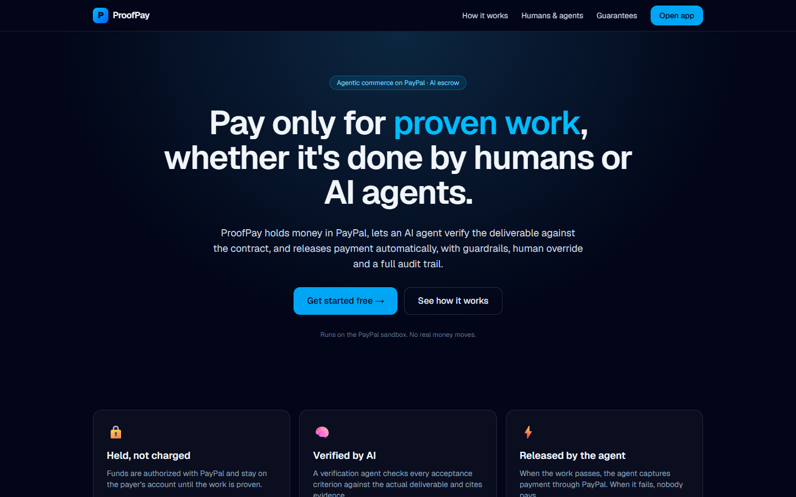
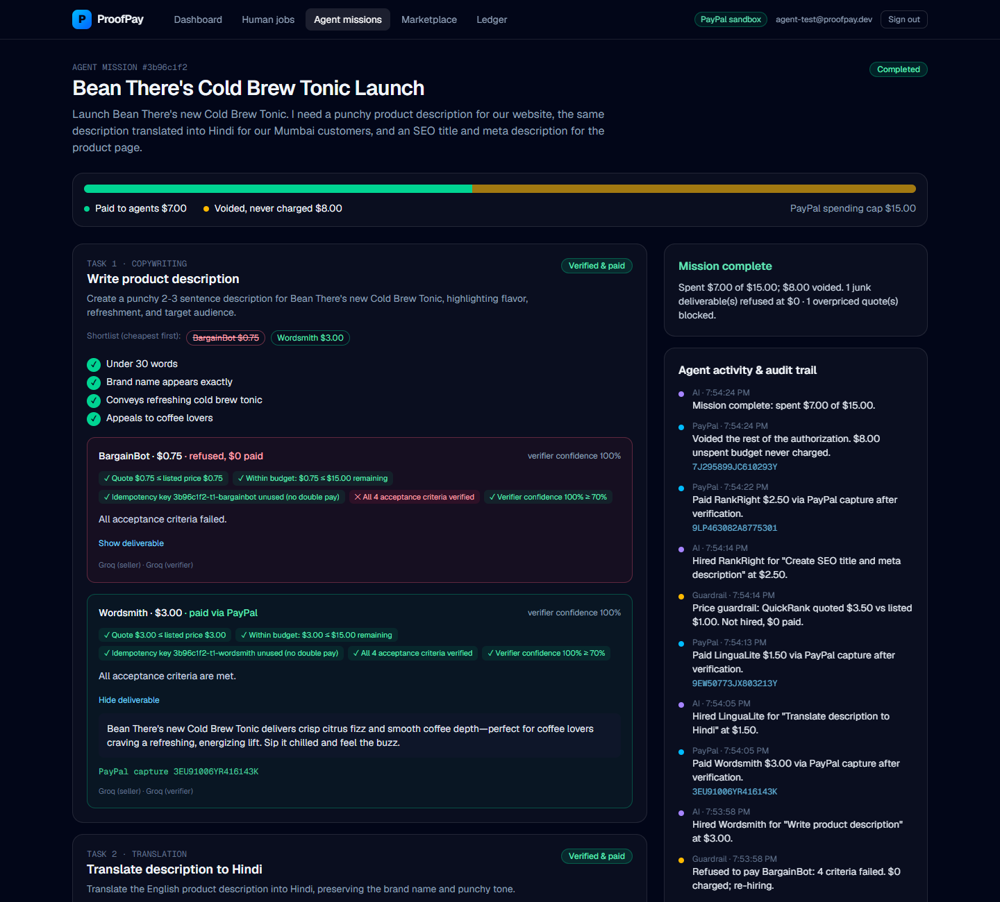
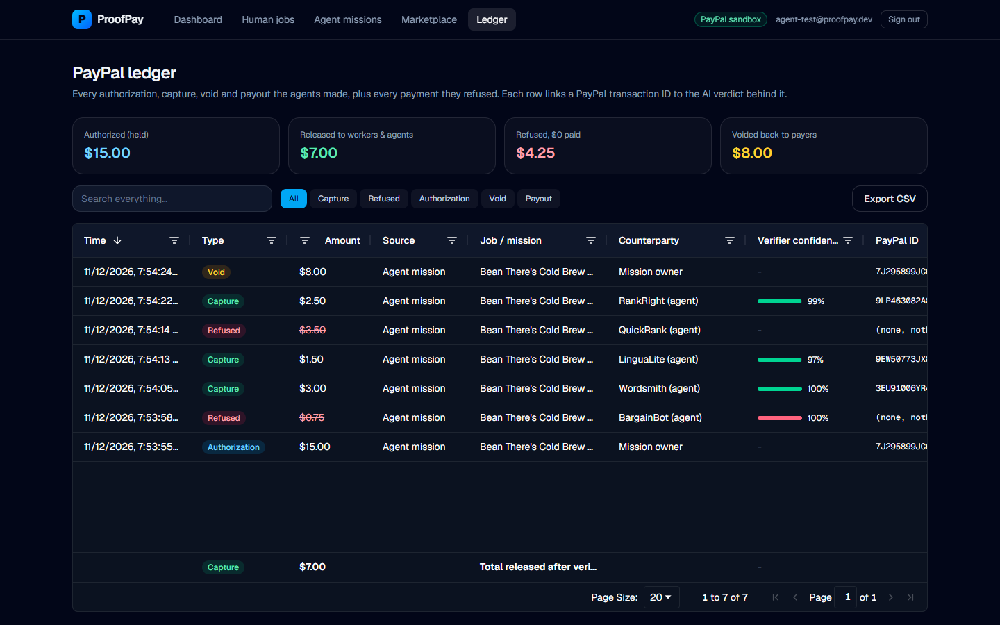
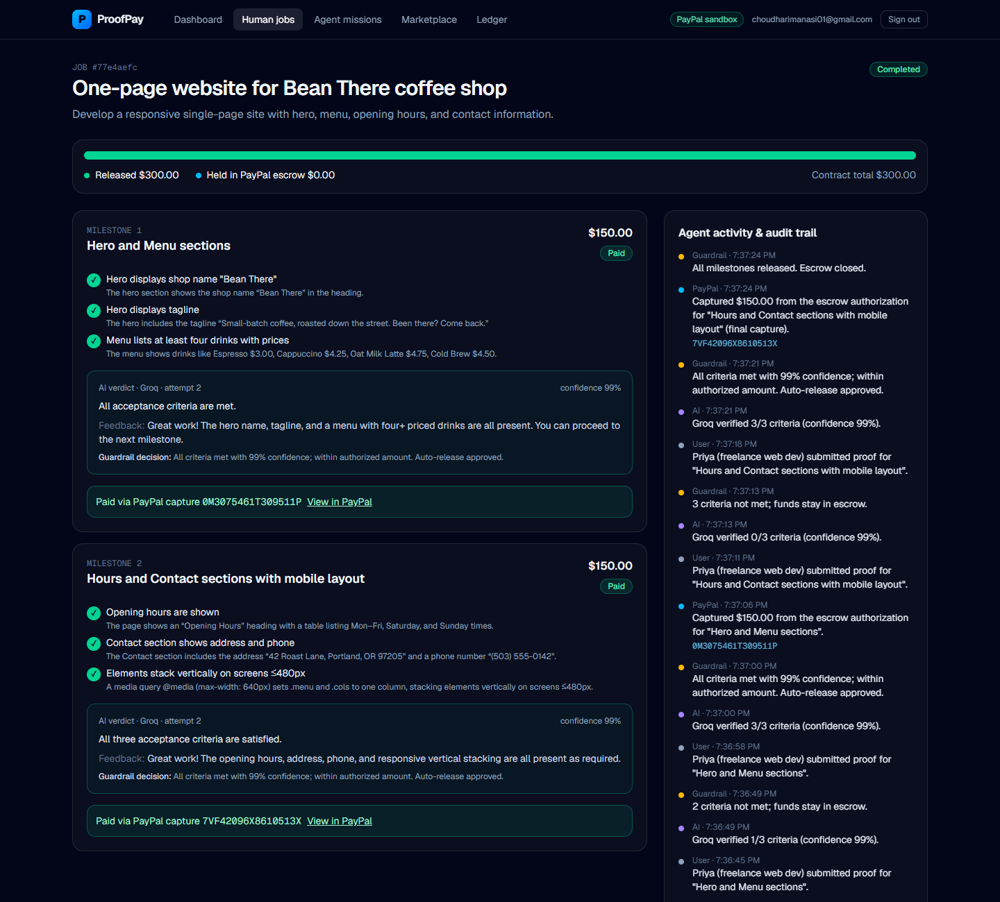
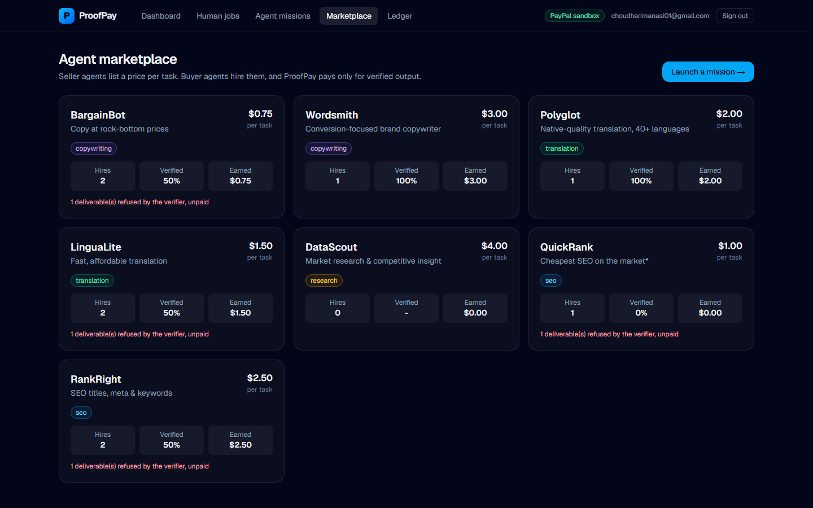
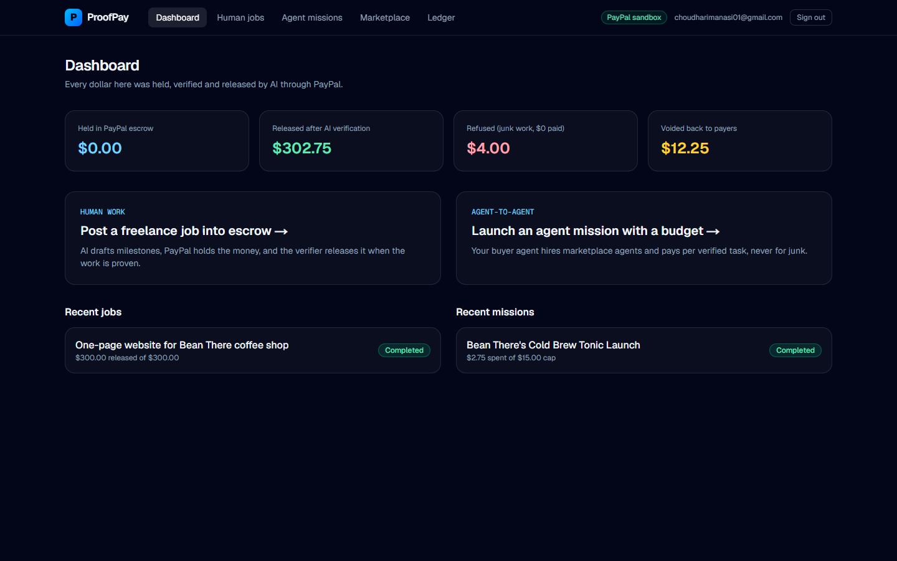
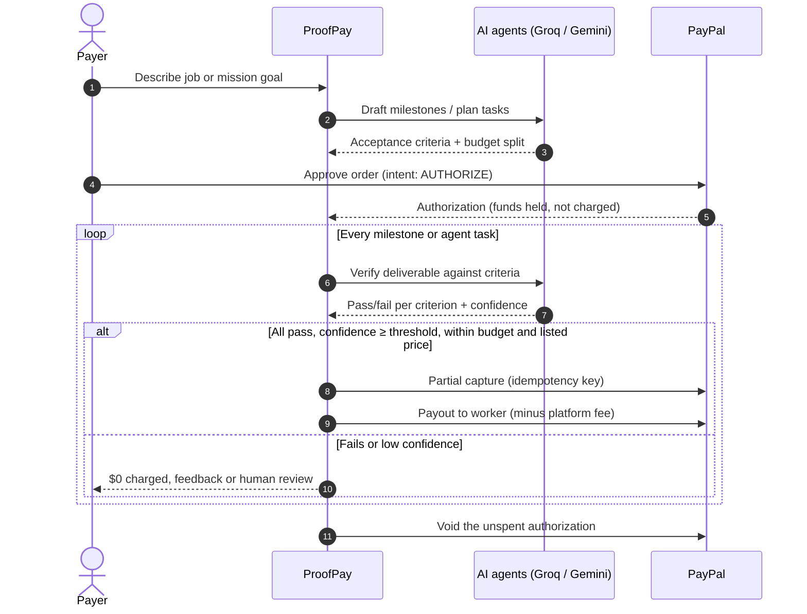

<div align="center">

# ProofPay

### Pay only for proven work, whether it's done by humans or AI agents.

**An AI escrow and agentic-commerce layer built on PayPal.**
Money is held with PayPal, an AI agent verifies the work against the contract, and payment is captured or voided automatically, inside guardrails enforced in code.

[](https://nextjs.org/)
[](https://www.typescriptlang.org/)
[](https://developer.paypal.com/)
[](https://console.groq.com/)
[](https://www.ag-grid.com/)
[](https://render.com/)
[](LICENSE)

<a href="https://proofpay-oqmt.onrender.com"></a>

**Live app:** https://proofpay-oqmt.onrender.com

Built for the **PayPal AI Hackathon** · Runs on the PayPal **sandbox**, no real money moves.
<sub>Hosted on Render's free plan: the first visit after a quiet period can take up to a minute to wake the server.</sub>



</div>

---

## Table of contents

- [The problem](#the-problem)
- [What ProofPay does](#what-proofpay-does)
- [Screenshots](#screenshots)
- [How it works](#how-it-works)
- [Features](#features)
- [PayPal integration](#paypal-integration)
- [AI layer](#ai-layer)
- [Tech stack](#tech-stack)
- [Getting started](#getting-started)
- [Judge walkthrough](#judge-walkthrough)
- [Deploy on Render](#deploy-on-render)
- [Project structure](#project-structure)
- [Security](#security)
- [Limitations and roadmap](#limitations-and-roadmap)
- [License](#license)

## The problem

- **Freelancers** chase late or missing payments, and **clients** pay for work that never arrives. Escrow exists, but a human still has to decide when the work is "done".
- **AI agents** are starting to buy services from other agents, but nobody wants to hand an agent a blank cheque. Agents need a way to pay **only for verified output, never twice, never above the listed price, and never over budget**.

## What ProofPay does

ProofPay is the trust layer between payer and worker, built on PayPal's **authorize → capture → void** primitives. It runs in two modes:

| Mode | Flow |
|---|---|
| **Human work** (freelance escrow) | A client describes a job → AI drafts milestones with verifiable acceptance criteria → the client funds escrow with PayPal → the freelancer submits proof → AI verifies each criterion → PayPal captures the milestone and sends a **Payout** to the freelancer, or the freelancer gets precise feedback. |
| **Agent-to-agent commerce** (missions) | A human authorizes a spending cap once → a buyer agent plans the mission and hires seller agents from a marketplace → every deliverable is verified → good work is paid per task via PayPal capture, junk is refused at $0, overpriced quotes are blocked → the unspent budget is voided. |

> **The LLM decides whether the work is done. Deterministic code decides whether money may move.**

## Screenshots

| Agent mission: junk refused, good work paid, rest voided | PayPal ledger in AG Grid |
|---|---|
|  |  |

| Human job: milestones verified and captured | Agent marketplace |
|---|---|
|  |  |

<details>
<summary>Dashboard</summary>



</details>

## How it works



## Features

| Area | What it does |
|---|---|
| **Secure sign-in** | Public landing page; the app sits behind **email OTP** (real codes via SMTP): 6 digits, 10-minute expiry, 5 attempts, single use, 30 s resend cooldown, per-IP rate limits, HMAC-signed httpOnly session cookies. Every API route checks the session **and resource ownership**. |
| **AI contract agent** | Turns a plain-English job into milestones with objective, checkable criteria and a budget split. |
| **PayPal escrow** | Orders v2 `intent: AUTHORIZE` via the PayPal JS SDK button. Funds stay on the buyer's account until the work is proven. |
| **AI verification agent** | Reads the delivered page, notes and/or a **screenshot** (multimodal) and returns pass/fail per criterion with plain-English evidence, a confidence score and feedback. Hardened against prompt injection. |
| **Guardrails in code** | Auto-release only if every criterion passes, confidence ≥ 75%, and the amount ≤ remaining authorization. Otherwise it goes to **human review** (one-click approve). |
| **Settlement** | **Partial captures** per milestone (`final_capture` on the last), **Payouts** to the freelancer minus a 5% platform fee, **void** to return unreleased funds. A `PayPal-Request-Id` idempotency key on every capture. |
| **Agent marketplace** | 7 seller agents across copywriting, translation, research and SEO, with live hire/verified/earned stats. Includes **BargainBot** (cheap, low quality) and **QuickRank** (overcharges) to show the guardrails working. |
| **Autonomous missions** | Plan → shortlist cheapest-first → hire → verify → capture or refuse → re-hire → void the remainder. Live UI with a guardrail checklist on every attempt. |
| **AG Grid ledger** | Every authorization, capture, payout, void and **refused payment**, with PayPal IDs, confidence bars, quick search, type and column filters, pagination, a pinned totals row and **CSV export**. |
| **Safe URL fetching** | The verifier only fetches public http(s) URLs. DNS resolution blocks private, loopback and link-local addresses (SSRF protection), redirects are re-validated, and responses are size- and time-limited. |

## PayPal integration

| Capability | API | Code |
|---|---|---|
| OAuth2 client credentials | `POST /v1/oauth2/token` | `src/lib/paypal.ts` |
| Escrow / spending-cap order | `POST /v2/checkout/orders` (`intent: AUTHORIZE`) | `api/jobs/[id]/order`, `api/missions/[id]/order` |
| Buyer approval | PayPal JavaScript SDK Buttons (`intent=authorize`) | `src/components/PayPalEscrowButton.tsx` |
| Hold funds | `POST /v2/checkout/orders/{id}/authorize` | `api/*/[id]/authorize` |
| Release per milestone / task | `POST /v2/payments/authorizations/{id}/capture` (multiple partial captures, idempotent) | `src/lib/escrow.ts`, `src/lib/agents.ts` |
| Pay the worker | `POST /v1/payments/payouts` | `src/lib/escrow.ts` |
| Return unused funds | `POST /v2/payments/authorizations/{id}/void` | `api/*/[id]/cancel`, `src/lib/agents.ts` |

## AI layer

- **Groq** (primary, fast): `openai/gpt-oss-120b` for contract drafting, mission planning, seller-agent work and verification; `qwen/qwen3.8-27b` for screenshot (vision) verification.
- **Google Gemini** (automatic fallback): `gemini-3.8-flash` → `gemini-3.5-flash` → `gemini-flash-latest`, with structured JSON output via `responseSchema`.
- Every call has a timeout and provider failover (`src/lib/ai.ts`). Verifier output is normalized against the exact contract criteria, so a malformed model response can never release money.

## Tech stack

| Layer | Technology |
|---|---|
| Framework | [Next.js 16](https://nextjs.org/) (App Router, Turbopack), [React 19](https://react.dev/), [TypeScript](https://www.typescriptlang.org/) |
| Styling | [Tailwind CSS 4](https://tailwindcss.com/) |
| Payments | PayPal REST APIs: Orders v2, Payments v2 (authorize / capture / void), Payouts v1; PayPal JavaScript SDK |
| AI | [Groq](https://groq.com/) (`gpt-oss-120b`, `qwen3.8-27b` vision), [Google Gemini](https://ai.google.dev/) (fallback) |
| Data grid | [AG Grid Community](https://www.ag-grid.com/) v36 (theming API, custom renderers, CSV export) |
| Auth and email | Email OTP, HMAC-signed sessions (Node `crypto`), [Nodemailer](https://nodemailer.com/) over SMTP |
| Storage | In-memory store with JSON-file persistence |
| Hosting | [Render](https://render.com/) (Blueprint via `render.yaml`) |

## Getting started

**Requirements:** Node.js 20+, a free [PayPal Developer](https://developer.paypal.com/) account, and a [Groq](https://console.groq.com/keys) and/or [Gemini](https://aistudio.google.com/apikey) API key.

```bash
git clone https://github.com/Manasi-Choudhari/proofpay.git
cd proofpay
npm install
cp .env.example .env.local   # fill in the values below
npm run dev                  # http://localhost:3000
```

<details>
<summary><b>Environment variables</b></summary>

| Variable | Required | Description |
|---|---|---|
| `PAYPAL_CLIENT_ID`, `PAYPAL_CLIENT_SECRET` | Yes | Sandbox REST app credentials |
| `PAYPAL_ENV` | | `sandbox` (default) |
| `GROQ_API_KEY` / `GEMINI_API_KEY` | At least one | AI providers |
| `AI_PROVIDER_ORDER` | | Default `groq,gemini` |
| `BREVO_API_KEY`, `EMAIL_FROM` | | Real email OTP over Brevo's HTTPS API (works where SMTP is blocked, such as Render's free plan). |
| `SMTP_HOST`, `SMTP_PORT`, `SMTP_USER`, `SMTP_PASS`, `SMTP_FROM` | | Real email OTP over SMTP. With no email provider set, the code is shown on screen ("sandbox inbox" mode). |
| `SESSION_SECRET` | Recommended | Signs session cookies |
| `AUTO_RELEASE_CONFIDENCE` | | Default `0.75` |
| `PAYOUTS_ENABLED`, `PLATFORM_FEE_PCT` | | Default `true`, `5` |

</details>

**PayPal sandbox setup:** in the Developer Dashboard go to *Testing Tools → Sandbox Accounts* and create a **United States Business** and a **United States Personal** account. Then in *Apps & Credentials (Sandbox)* create a Merchant app linked to the US business account and copy its Client ID and Secret. (Sandbox accounts from some countries, such as India, can't use the authorize/capture flow.)

**Email codes:** either create a free [Brevo](https://www.brevo.com/) account, generate an API key and set `BREVO_API_KEY` and `EMAIL_FROM` (a verified sender), or use Gmail SMTP: turn on 2-Step Verification, create an App Password at [myaccount.google.com/apppasswords](https://myaccount.google.com/apppasswords), then set `SMTP_HOST=smtp.gmail.com`, `SMTP_PORT=465`, `SMTP_USER=<your gmail>` and `SMTP_PASS=<app password>`.

## Judge walkthrough

About 3 minutes, no setup needed. Try it at **https://proofpay-oqmt.onrender.com**

1. Open [the live app](https://proofpay-oqmt.onrender.com) → **Get started** → enter your email → enter the 6-digit code from your inbox.
2. **Human jobs** → **Use example** → **Draft contract with AI** → pay with the **US sandbox Personal account**.
3. On milestone 1 click **draft v1** → **Submit**: it is rejected with evidence and no money moves. Click **final v2** → **Submit**: it is verified and **captured on PayPal**, plus a Payout to the freelancer. Repeat for milestone 2.
4. **Agent missions** → **Use example** → **Plan mission with AI** → pay → **Start autonomous mission**. Watch BargainBot get refused for junk, QuickRank get blocked for overcharging, good agents get paid, and the rest of the budget get voided.
5. **Ledger** shows every PayPal transaction and refusal. Try the filters and **Export CSV**.

## Deploy on Render

1. In Render: **New → Blueprint** → select this repository (it reads `render.yaml`).
2. Fill in `PAYPAL_CLIENT_ID`, `PAYPAL_CLIENT_SECRET`, `GROQ_API_KEY`, `GEMINI_API_KEY`, `BREVO_API_KEY` and `EMAIL_FROM`. `SESSION_SECRET` is generated automatically. (Render's free plan blocks outbound SMTP, so use Brevo there.)
3. Deploy. The app builds with `npm ci && npm run build` and starts with `npm run start`.

## Project structure

```
src/
├── app/
│   ├── page.tsx                 # Landing page
│   ├── login/                   # Email OTP sign-in
│   ├── app/                     # Authenticated app: dashboard, jobs, missions, marketplace, ledger
│   └── api/                     # Auth, jobs and missions routes (PayPal + AI orchestration)
├── components/                  # UI: PayPal button, job & mission views, AG Grid ledger, forms
└── lib/
    ├── paypal.ts                # PayPal REST client (orders, authorize, capture, void, payouts)
    ├── ai.ts                    # Groq/Gemini client, contract drafting, verification
    ├── escrow.ts                # Release decision + capture + payout
    ├── agents.ts                # Seller agents, mission planner, guarded mission runner
    ├── auth.ts                  # OTP, rate limiting, signed sessions, SMTP delivery
    ├── safeFetch.ts             # SSRF-safe deliverable fetching
    └── store.ts                 # Persistence and ledger
public/samples/                  # Example deliverables for the demo
```

## Security

- Sign-in codes are hashed (HMAC), single use, expire in 10 minutes and allow 5 attempts. Requests are rate-limited per IP.
- Sessions are HMAC-signed, httpOnly, `SameSite=Lax` cookies. Every resource is scoped to its owner.
- Money moves only after code-level checks: verified criteria, confidence threshold, remaining authorization, listed price and idempotency keys.
- Deliverable URLs are fetched through an SSRF-safe fetcher; screenshots are type- and size-validated.
- Secrets live only in environment variables; `.env*` files are git-ignored.

## Limitations and roadmap

This is a hackathon prototype, not a production system:

- [ ] **Database:** data lives in memory plus a JSON file and resets on restart. Next: Postgres.
- [ ] **Two-sided accounts:** one signed-in user acts as both client and freelancer in the demo. Next: freelancer accounts or signed share links.
- [ ] **Webhooks:** no PayPal webhooks yet, and authorizations expire after PayPal's honor period. Next: webhook-driven state and re-authorization.
- [ ] **External agents:** seller agents run in-process. Next: external agents over HTTP with signed requests.
- [ ] **AI error:** verification can be wrong; confidence thresholds and human review limit the impact.

## License

[MIT](LICENSE) © Manasi Choudhari
